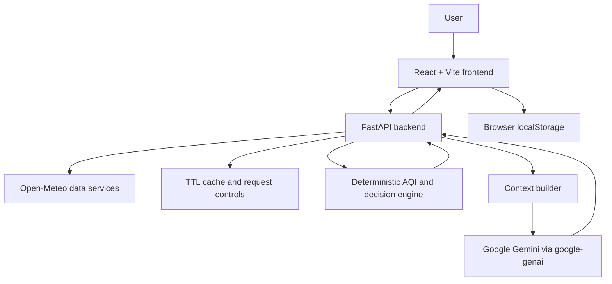

# AirWise

**Breathe Smarter. Live Cleaner.**

AirWise is an AI-powered urban air quality assistant built for the **Google Developers × Hack2Skill PromptWars Virtual Challenge 06**. It helps people understand outdoor air quality, assess household sensitivity, make safer day-to-day decisions, and adopt practical actions to reduce exposure to air pollution.

<p align="center">
  <a href="https://airwise-frontend-rftk1wvcx-tousif15.vercel.app/"><strong>Live Application</strong></a> ·
  <a href="https://airwise-backend-j2g7.onrender.com/docs"><strong>API Documentation</strong></a> ·
  <a href="docs/architecture.md"><strong>Architecture</strong></a>
</p>

## Overview

Air pollution data is often difficult to interpret and turn into useful everyday decisions. AirWise brings air-quality information, household context, and actionable guidance together in one interface.

The application combines live and cached environmental data with deterministic decision logic and a Gemini-powered assistant. It is designed to communicate data quality and limitations clearly rather than presenting estimates as measured facts.

## Features

- **Air-quality dashboard:** View current conditions, pollutant details, and air-quality information for supported locations.
- **Multiple AQI standards:** Keep CPCB, US AQI, and European AQI interpretations separate instead of treating their scales as interchangeable.
- **AI air-quality assistant:** Ask questions and receive context-grounded explanations and recommendations based on available environmental data.
- **Household-aware guidance:** Use a household sensitivity profile to make recommendations more relevant to the people using the application.
- **Indoor air-quality advisor:** Get practical indoor protection suggestions using outdoor conditions and user-provided home-environment details. The application does not claim to measure indoor air.
- **Environmental impact tracker:** Record sustainable actions and view estimated impact. Modelled estimates are identified as estimates, not direct measurements.
- **Resilient data handling:** Use caching, request controls, and fallback behaviour to handle upstream delays and rate limits more gracefully.

## Live Deployments

| Component | Link |
|---|---|
| Frontend | [Open AirWise](https://airwise-frontend-rftk1wvcx-tousif15.vercel.app/) |
| Backend API | [Open API](https://airwise-backend-j2g7.onrender.com/) |
| Swagger documentation | [Explore endpoints](https://airwise-backend-j2g7.onrender.com/docs) |
| Health check | [Check API health](https://airwise-backend-j2g7.onrender.com/api/v1/health) |

## System Architecture



### Technology Stack

| Layer | Technologies |
|---|---|
| Frontend | React, Vite, Tailwind CSS, Recharts, Lucide |
| Backend | Python, FastAPI, Pydantic v2, Uvicorn |
| AI assistant | Google Gemini, official `google-genai` SDK |
| Environmental data | Open-Meteo APIs |
| Testing | Pytest, pytest-asyncio, Node.js test runner |
| Deployment | Vercel (frontend), Render (backend) |

## Data Integrity and Safety

AirWise aims to make the meaning and reliability of its information clear:

- **AQI standards remain distinct.** CPCB, US AQI, and European AQI are handled as separate systems; their values and categories should not be directly substituted for one another.
- **CPCB calculations follow pollutant-specific requirements.** The implementation applies the relevant averaging and minimum-observation checks before producing a CPCB AQI result.
- **Observations, estimates, and forecasts are distinguished.** A modelled value or forecast is not presented as a live sensor observation.
- **Data availability is explicit.** Responses can distinguish live, cached, and unavailable data states.
- **AI responses are grounded.** The assistant receives relevant application context and has a rule-based fallback path when Gemini is unavailable.
- **No indoor sensor readings are fabricated.** Indoor recommendations use user-provided home details and available outdoor conditions.
- **Impact figures are estimates.** Environmental impact calculations use configurable assumptions and should be interpreted as indicative rather than audited measurements.

For implementation details and design decisions, see [docs/architecture.md](docs/architecture.md).

## Project Structure

```text
airwise/
├── backend/
│   ├── app/
│   │   ├── api/
│   │   │   └── routes/
│   │   ├── core/
│   │   ├── schemas/
│   │   ├── services/
│   │   └── main.py
│   ├── .env.example
│   └── requirements.txt
├── docs/
│   └── architecture.md
├── frontend/
│   ├── src/
│   │   ├── components/
│   │   ├── pages/
│   │   ├── services/
│   │   └── utils/
│   ├── .env.example
│   └── package.json
├── tests/
│   ├── test_air_quality_api.py
│   ├── test_assistant.py
│   ├── test_cpcb_aqi.py
│   ├── test_indoor_advisor.py
│   ├── test_production_config.py
│   └── test_rate_limit_and_cache.py
├── render.yaml
└── README.md
```

## Run Locally

### Prerequisites

- Python 3.12 or newer
- Node.js and npm
- A Google Gemini API key for enabling Gemini-backed assistant responses

### 1. Clone the repository

```powershell
git clone https://github.com/Tousif18/airwise.git
cd airwise
```

### 2. Configure and run the backend

```powershell
cd backend
Copy-Item .env.example .env
python -m venv .venv
.\.venv\Scripts\Activate.ps1
pip install -r requirements.txt
```

Open `backend/.env` and add your Gemini API key to the relevant setting:

```env
GEMINI_API_KEY=your_gemini_api_key
```

Then start the API:

```powershell
uvicorn app.main:app --reload --host 127.0.0.1 --port 8000
```

The backend will be available at [http://127.0.0.1:8000](http://127.0.0.1:8000). Interactive API documentation is available at [http://127.0.0.1:8000/docs](http://127.0.0.1:8000/docs).

### 3. Configure and run the frontend

Open a second terminal from the repository root:

```powershell
cd frontend
Copy-Item .env.example .env
```

The local frontend environment should point to the local backend:

```env
VITE_API_BASE_URL=http://127.0.0.1:8000
```

Install dependencies and start the development server:

```powershell
npm install
npm run dev
```

Vite will print the local frontend URL in the terminal.

## API Endpoints

The backend exposes versioned endpoints under `/api/v1`.

| Method | Endpoint | Purpose |
|---|---|---|
| GET | `/api/v1/health` | Backend health check |
| GET | `/api/v1/locations/presets` | Retrieve preset locations |
| GET | `/api/v1/locations/search` | Search supported locations |
| GET | `/api/v1/air-quality` | Retrieve air-quality information |
| GET / PUT | `/api/v1/family/profile` | Read or update the household profile |
| GET | `/api/v1/assistant/health` | Check assistant readiness and fallback availability |
| POST | `/api/v1/assistant/chat` | Send a question to the AI assistant |
| POST | `/api/v1/assistant/recommendations` | Generate structured household recommendations |
| POST | `/api/v1/indoor/recommendations` | Generate indoor air-quality recommendations |

See the interactive [Swagger API documentation](https://airwise-backend-j2g7.onrender.com/docs) for request schemas and response details.

## Running Tests

### Backend

From the repository root:

```powershell
cd backend
python -m pytest ..\tests -v
```

### Frontend

From the repository root:

```powershell
cd frontend
npm install
npm test
```

## Privacy and Limitations

- Household profile and impact-tracker information use browser `localStorage`; they are stored in the user's browser rather than represented as a central medical record.
- AirWise is an informational tool, not a substitute for official public-health guidance or professional medical advice.
- Indoor recommendations are advisory and do not replace readings from dedicated indoor air-quality monitors.
- Data coverage and freshness depend on the upstream data provider, network availability, and caching.
- AI-generated explanations can be incomplete or incorrect; users should check important information against trusted official sources.

## Roadmap

Potential future improvements include broader location coverage, additional data-source integrations, more comprehensive accessibility and language support, and expanded validation of recommendations across real-world scenarios.

## Acknowledgements

Built for the **Google Developers × Hack2Skill PromptWars Virtual Challenge 06**.

---

If you find a bug or have a suggestion, feel free to open an issue or contribute to the project.
